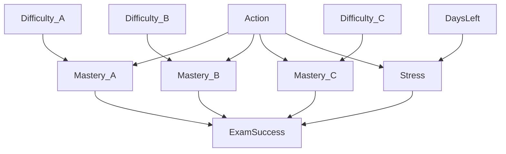

# Bayesian Study Planner

[](https://github.com/sonoftirit/bayesian-study-planner/actions/workflows/ci.yml)

A personalised study planner that decides **what kind of study day you should
have** before an exam, and puts that decision straight into your Google
Calendar.

Instead of fixed rules like "study 2 hours a day", the planner reasons under
uncertainty. It uses a hand-crafted **Bayesian network** to estimate how likely
you are to pass and how stressed you are likely to be, then uses a **utility
function** to pick the action that best balances exam success against
last-minute cramming stress.

> Term project for **COSC 329: Learning Analytics** (Option 3: Bayesian
> Calendar, one-person version). 🚧 Work in progress. See [Project
> status](#project-status).

---

## Table of contents

- [Why this project](#why-this-project)
- [How it works](#how-it-works)
  - [1. Inputs](#1-inputs)
  - [2. The Bayesian network](#2-the-bayesian-network)
  - [3. Inference](#3-inference)
  - [4. Utility and decision](#4-utility-and-decision)
  - [5. Calendar](#5-calendar)
- [Demo scenarios](#demo-scenarios)
- [Project status](#project-status)
- [Tech stack](#tech-stack)
- [Getting started](#getting-started)
- [Running the tests](#running-the-tests)
- [Project structure](#project-structure)

---

## Why this project

Students often plan study time badly in two ways: they rest when they should be
studying, or they cram in a panic right before the exam. A good plan depends on
things that are uncertain, like how well you will really know each topic or how
stressed you will feel.

Bayesian networks are a natural fit for this. They model uncertain variables and
how they influence each other, and they update their beliefs when you give them
evidence (for example: "this concept is hard for me and the exam is in 2 days").
Combined with a utility function, the network can make a **principled
decision** rather than a guess.

## How it works

```
 your situation  ──►  Bayesian network  ──►  P(pass, stress)  ──►  expected utility  ──►  best action  ──►  Google Calendar
 (difficulty,          (pgmpy)               for each action        for each action
  days left)
```

### 1. Inputs

- **The exam date.** This becomes `DaysLeft`: *Few* (3 days or fewer) or *Many*.
- **How hard each of 3 course concepts is for you**: *Easy* or *Hard*.

### 2. The Bayesian network

The model has **10 discrete variables**. Every probability in it is chosen by
hand and justified in the design document.

| Variable | States | Depends on | Meaning |
|---|---|---|---|
| `Difficulty_A`, `Difficulty_B`, `Difficulty_C` | Easy, Hard | (none) | How hard each concept is for this student (observed) |
| `DaysLeft` | Few, Many | (none) | Time until the exam (observed) |
| `Action` | Intense, Light, Rest | (none) | Today's decision (set by the planner) |
| `Mastery_A`, `Mastery_B`, `Mastery_C` | Low, High | Difficulty, Action | How well each concept is known after today |
| `Stress` | Low, High | Action, DaysLeft | Student stress level |
| `ExamSuccess` | Fail, Pass | All 3 Mastery nodes, Stress | Whether the student passes |



### 3. Inference

For each possible action `a`, the planner asks the network:

> **P(ExamSuccess, Stress | Difficulty_A, Difficulty_B, Difficulty_C, DaysLeft, Action = a)**

`ExamSuccess` and `Stress` are the **query variables**. The answer is computed
exactly with pgmpy's built-in **Variable Elimination** algorithm.

### 4. Utility and decision

Each combination of outcomes gets a utility score. Passing matters most, and
low stress is a bonus:

| | Stress = Low | Stress = High |
|---|:---:|:---:|
| **Pass** | 100 | 70 |
| **Fail** | 20 | 0 |

The **expected utility** of an action is the average utility, weighted by how
likely each outcome is:

```
EU(a) = Σ  P(success, stress | evidence, a) × U(success, stress)
```

The planner picks the action with the **highest expected utility**.

### 5. Calendar

The chosen action becomes an event in a dedicated "Study Planner" Google
Calendar, in the `America/Vancouver` time zone:

| Action | Calendar event |
|---|---|
| **Intense** | "Intense study block", 5 hours, today |
| **Light** | "Light review session", 1 hour, today |
| **Rest** | All-day "Rest day", today |

## Demo scenarios

To show that the planner adapts to the student, it will be run on predefined
student profiles. The expected behaviour is:

| Scenario | Evidence | Expected action |
|---|---|---|
| Struggling student | All concepts Hard, few days left | Intense |
| Average student | Mixed difficulty | Light |
| Advanced student | All concepts Easy, many days left | Rest |

These answers are **not hard-coded**. They have to come out of the network and
the utility function. Full results with expected-utility tables will be added
to `docs/results.md`.

## Project status

| Stage | Description | Status |
|---|---|:---:|
| 0 | Project setup (environment, dependencies, repository) | ✅ |
| 1 | Continuous integration with GitHub Actions | ✅ |
| 1.5 | Google Calendar connection test (OAuth login, test event) | ✅ |
| 2 | Bayesian network structure and probability tables | ⏳ |
| 3 | Inference with Variable Elimination | ⏳ |
| 4 | Utility function and decision making | ⏳ |
| 5 | Full Google Calendar integration | ⏳ |
| 6 | Command-line program | ⏳ |
| 7 | Scenario results | ⏳ |
| 8 | Final documentation and presentation | ⏳ |

## Tech stack

| Purpose | Tool |
|---|---|
| Language | Python 3.14 |
| Bayesian network and inference | [pgmpy](https://pgmpy.org/) |
| Calendar | Google Calendar API (`google-api-python-client`, `google-auth-oauthlib`) |
| Dates and time zones | `datetime`, `zoneinfo` |
| Testing | `pytest`, `pytest-cov`, `unittest.mock` |
| Linting and formatting | `ruff` |
| Continuous integration | GitHub Actions |

## Getting started

### Prerequisites

- Python 3.14
- Git
- A Google account (for the calendar features)

### 1. Clone and install

```powershell
git clone https://github.com/sonoftirit/bayesian-study-planner.git
cd bayesian-study-planner
py -V:3.14 -m venv .venv
.\.venv\Scripts\Activate.ps1
pip install -r requirements-dev.txt
```

On macOS or Linux, create the environment with `python3.14 -m venv .venv` and
activate it with `source .venv/bin/activate`.

### 2. Set up Google Calendar access

The planner needs its own OAuth client to talk to your calendar. This is a
one-time setup in the [Google Cloud Console](https://console.cloud.google.com/):

1. Create a new project.
2. Enable the **Google Calendar API**.
3. Under **Google Auth Platform**, configure the consent screen: audience
   **External**, publishing status **Testing**, and add your Google account as a
   **test user**.
4. Create an **OAuth client** of type **Desktop app** and download its JSON file.
5. Save that file in the project folder as `credentials.json`.

`credentials.json` and `token.json` (your saved login) are listed in
`.gitignore`, so they are never committed.

### 3. Test the connection

```powershell
python -m planner.calendar_client
```

The first run opens your browser to log in. Because the app is in testing mode,
Google shows an "unverified app" warning, which is expected for a personal
project. The program then creates a 30-minute "Study Planner connection test"
event in your calendar and prints a link to it.

## Running the tests

```powershell
pytest -v --cov=planner   # tests with a coverage report
ruff check .              # lint
ruff format --check .     # formatting
```

The calendar tests replace Google's service with a mock object, so the test
suite never needs credentials or a network connection. GitHub Actions runs the
same three commands on every push and pull request.

## Project structure

```
bayesian-study-planner/
├── .github/workflows/ci.yml   # CI: lint + tests on every push and pull request
├── planner/
│   ├── __init__.py
│   └── calendar_client.py     # Google OAuth login and event creation
├── tests/
│   ├── test_package.py
│   └── test_calendar_client.py
├── pyproject.toml             # ruff and pytest settings
├── requirements.txt           # runtime dependencies (pinned)
└── requirements-dev.txt       # testing and linting tools (pinned)
```

Planned additions: `planner/network.py` (the Bayesian network),
`planner/decision.py` (inference, utility and best action),
`planner/scenarios.py`, `planner/main.py` (command-line program), and
`docs/design.md` and `docs/results.md`.
