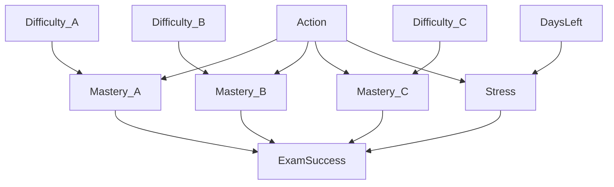

# Design: Bayesian Network for Study Planning

This document describes the Bayesian network in
[`planner/network.py`](../planner/network.py): its variables, its structure,
every conditional probability table (CPT), and the reasoning behind each
number. All tables below are printed directly from the code, so they match the
model exactly.

## 1. Variables

The network has **10 discrete variables**. This is the maximum the
one-person version of the assignment allows.

| Variable | States | Parents | Role | Meaning |
|---|---|---|---|---|
| `Difficulty_A` | Easy, Hard | (none) | Evidence | How hard concept A is for this student |
| `Difficulty_B` | Easy, Hard | (none) | Evidence | How hard concept B is for this student |
| `Difficulty_C` | Easy, Hard | (none) | Evidence | How hard concept C is for this student |
| `DaysLeft` | Few, Many | (none) | Evidence | Days until the exam. **Few** means 3 days or fewer. |
| `Action` | Intense, Light, Rest | (none) | Decision | Today's study action, set by the planner |
| `Mastery_A` | Low, High | `Difficulty_A`, `Action` | Hidden | How well concept A is known after today |
| `Mastery_B` | Low, High | `Difficulty_B`, `Action` | Hidden | How well concept B is known after today |
| `Mastery_C` | Low, High | `Difficulty_C`, `Action` | Hidden | How well concept C is known after today |
| `Stress` | Low, High | `Action`, `DaysLeft` | **Query** | The student's stress level |
| `ExamSuccess` | Fail, Pass | `Mastery_A`, `Mastery_B`, `Mastery_C`, `Stress` | **Query** | Whether the student passes the exam |

The three actions are:

| Action | Meaning | Calendar event |
|---|---|---|
| **Intense** | Mandatory 5-hour study block today | "Intense study block", 5 hours |
| **Light** | 1-hour review session today | "Light review session", 1 hour |
| **Rest** | No studying today | All-day "Rest day" |

## 2. Structure

Why these edges:

- **Difficulty → Mastery:** a hard concept is less likely to be mastered than
  an easy one, whatever the student does.
- **Action → Mastery:** more study time today means a better chance of
  mastering each concept.
- **Action → Stress:** a long, mandatory study block is tiring. A day off is
  relaxing, but only if there is time to spare.
- **DaysLeft → Stress:** a close deadline raises stress regardless of the
  action.
- **Mastery → ExamSuccess:** the more concepts the student knows, the more
  likely they pass.
- **Stress → ExamSuccess:** high stress hurts exam performance, for example
  through anxiety, poor sleep and mistakes under pressure.

Difficulty does **not** point directly to `ExamSuccess`. Its effect on the exam
goes entirely through mastery: a hard concept only hurts you if you have not
mastered it. Stress is likewise not affected by difficulty. This keeps the
network small and each CPT easy to explain.

## 3. CPTs and justifications

### 3.1 Root nodes (priors)

| Variable | Prior | Justification |
|---|---|---|
| `Difficulty_A`, `Difficulty_B`, `Difficulty_C` | Easy 0.50, Hard 0.50 | Always observed (the student says how hard each concept is), so the prior never affects a query. Uniform means no built-in assumption. |
| `DaysLeft` | Few 0.50, Many 0.50 | Always observed (computed from the exam date). Uniform for the same reason. |
| `Action` | Intense 1/3, Light 1/3, Rest 1/3 | The decision variable. It is always set as evidence when querying, so a uniform prior simply means the model favours no action in advance. |

### 3.2 `Mastery_X` given `Difficulty_X` and `Action`

The same table is used for all three concepts.

| Difficulty | Action | P(Low) | P(High) | Justification |
|---|---|:---:|:---:|---|
| Easy | Intense | 0.05 | 0.95 | An easy concept plus a full study block is almost certainly mastered. |
| Easy | Light | 0.08 | 0.92 | One hour is plenty to refresh an easy concept, so it is nearly as good as an intense block. |
| Easy | Rest | 0.12 | 0.88 | Easy concepts are mostly known already. Skipping one day loses little. |
| Hard | Intense | 0.10 | 0.90 | Five focused hours are usually enough to master a hard concept. It stays a little below Easy + Intense (0.95) because hard material is never certain. |
| Hard | Light | 0.40 | 0.60 | One hour helps with a hard concept but often is not enough. A little better than a coin flip. |
| Hard | Rest | 0.75 | 0.25 | Without study, a hard concept usually stays poorly understood. |

**Pattern:** for every action, Easy is more likely to be mastered than Hard.
For every difficulty, Intense > Light > Rest. The *gap* between actions is
much larger for hard concepts (0.90 vs 0.25) than for easy ones (0.95 vs 0.88).
This is the key effect the planner exploits: studying pays off most where the
material is hard.

### 3.3 `Stress` given `Action` and `DaysLeft`

| Action | DaysLeft | P(Low) | P(High) | Justification |
|---|---|:---:|:---:|---|
| Intense | Few | 0.30 | 0.70 | A 5-hour mandatory block right before the exam is the classic cramming situation, so stress is most likely high. |
| Intense | Many | 0.50 | 0.50 | Still a long, tiring day, but with time to spare it feels less desperate. Even odds. |
| Light | Few | 0.65 | 0.35 | A short review keeps the student on track. Some stress remains because the exam is close. |
| Light | Many | 0.80 | 0.20 | A short, manageable session with plenty of time left: stress is usually low. |
| Rest | Few | 0.60 | 0.40 | Resting lowers effort, but taking a day off with the exam 3 days away or less causes guilt and worry. That is more stress than a light review. |
| Rest | Many | 0.95 | 0.05 | A day off with plenty of time left is the most relaxing option. |

**Pattern:** for every action, Few days left is more stressful than Many.
Intense is always the most stressful action. Rest is only the calmest choice
when the exam is far away.

### 3.4 `ExamSuccess` given `Mastery_A`, `Mastery_B`, `Mastery_C` and `Stress`

This table has 16 columns, so instead of typing 16 numbers by hand it is
generated from a simple rule (`pass_probability` in `network.py`):

1. Count how many of the three concepts are mastered (0 to 3).
2. Look up the base pass probability for **low stress**:

   | Concepts mastered | 0 | 1 | 2 | 3 |
   |---|:---:|:---:|:---:|:---:|
   | P(Pass \| low stress) | 0.10 | 0.35 | 0.70 | 0.95 |

3. If stress is **high**, subtract **0.15**, but never go below **0.05**.

Justification:

- **Base values.** The exam covers the three concepts equally, so only the
  count matters, not which concepts are mastered. Knowing nothing still leaves
  a small chance of passing (0.10) from partial marks and lucky guesses.
  Knowing everything is not a 100% guarantee (0.95) because careless mistakes
  happen. Each extra mastered concept adds roughly 0.25 to 0.35, and the
  biggest jump is from 1 to 2 concepts, which is where a typical pass mark
  (around 50%) is crossed.
- **Stress penalty (0.15).** High stress hurts performance, but less than
  missing a whole concept does. So the penalty is about half the gain from one
  extra mastered concept.
- **Floor (0.05).** Keeps every probability valid and non-zero. Without it,
  "nothing mastered and high stress" would give 0.10 − 0.15 = −0.05.

The full resulting table:

| # | Mastery_A | Mastery_B | Mastery_C | Stress | Mastered | P(Fail) | P(Pass) |
|---|---|---|---|---|:---:|:---:|:---:|
| 1 | Low | Low | Low | Low | 0 | 0.90 | 0.10 |
| 2 | Low | Low | Low | High | 0 | 0.95 | 0.05 |
| 3 | Low | Low | High | Low | 1 | 0.65 | 0.35 |
| 4 | Low | Low | High | High | 1 | 0.80 | 0.20 |
| 5 | Low | High | Low | Low | 1 | 0.65 | 0.35 |
| 6 | Low | High | Low | High | 1 | 0.80 | 0.20 |
| 7 | Low | High | High | Low | 2 | 0.30 | 0.70 |
| 8 | Low | High | High | High | 2 | 0.45 | 0.55 |
| 9 | High | Low | Low | Low | 1 | 0.65 | 0.35 |
| 10 | High | Low | Low | High | 1 | 0.80 | 0.20 |
| 11 | High | Low | High | Low | 2 | 0.30 | 0.70 |
| 12 | High | Low | High | High | 2 | 0.45 | 0.55 |
| 13 | High | High | Low | Low | 2 | 0.30 | 0.70 |
| 14 | High | High | Low | High | 2 | 0.45 | 0.55 |
| 15 | High | High | High | Low | 3 | 0.05 | 0.95 |
| 16 | High | High | High | High | 3 | 0.20 | 0.80 |

## 4. Inference task

**Query variables:** `ExamSuccess` and `Stress`.

**Evidence:** `Difficulty_A`, `Difficulty_B`, `Difficulty_C`, `DaysLeft`, and
the action being evaluated.

For **each** action `a` (Intense, Light, Rest), the planner computes the joint
distribution

> **P(ExamSuccess, Stress | Difficulty_A, Difficulty_B, Difficulty_C, DaysLeft, Action = a)**

using pgmpy's built-in **Variable Elimination** algorithm. This is exact
inference: it sums out the hidden `Mastery` nodes without any sampling or
approximation.

Why these two variables, and why *jointly*:

- The assignment asks for a decision that balances **exam success** against
  **stress**, so those are the two outcomes the utility function scores.
- `Stress` is a parent of `ExamSuccess`, so the two are **not independent**.
  Querying them separately and multiplying would give wrong probabilities. The
  joint query returns the correct probability of each of the four
  combinations, which is exactly what the utility table needs.

In code, this is `query_outcomes(evidence, action)` in
[`planner/decision.py`](../planner/decision.py). It returns a dictionary such
as `{("Pass", "Low"): 0.26, ...}`.

**Worked example: struggling student** (all concepts Hard, Few days left):

| Action | Pass, Low stress | Pass, High stress | Fail, Low stress | Fail, High stress | P(Pass) |
|---|:---:|:---:|:---:|:---:|:---:|
| Intense | 0.262 | 0.506 | 0.038 | 0.194 | **0.767** |
| Light | 0.400 | 0.165 | 0.250 | 0.185 | 0.565 |
| Rest | 0.182 | 0.078 | 0.418 | 0.322 | 0.260 |

Each row sums to 1. Intense gives by far the best chance of passing, but mostly
with high stress. Weighing that trade-off is the job of the utility function in
the next stage.

The results were cross-checked against an independent brute-force calculation
that multiplies all CPTs together and sums over the hidden variables. The two
agree to within 1e-15. The tests in `tests/test_decision.py` also compare one
case against a hand calculation.

## 5. How the numbers were tuned

The assignment requires the planner to choose **different actions for
different students**, and the choice must come from the model rather than
being hard-coded. Before the CPTs were written into the code, candidate values
were checked by computing the expected utility of each action for the demo
students (see the utility function in the README).

| Change from the first draft | Reason |
|---|---|
| Hard + Light mastery raised from 0.45 to **0.60** | With 0.45 a one-hour review was nearly worthless for a hard concept, so an average student was always pushed to Intense. An hour of focused review realistically gives a better-than-even chance. |
| Hard + Intense raised from 0.80 to **0.90**, and Hard + Rest from 0.20 to **0.25** | Shifts the Hard row up while keeping the order Intense > Light > Rest and the large gap between them. A student who rests still remembers a little of a hard concept. The final step from 0.85 to 0.90 came from an independent review. At 0.85 the struggling student's Intense won by only 2.85 points, and changing one probability by 0.05 could flip it. At 0.90 the margin is 5.81, and the other two demo students are unaffected. |
| Rest + Few stress raised from 0.35 to **0.40** | Taking a day off right before the exam should worry the student a bit more than a short review does. With 0.35, Rest and Light were equally calm. |
| Easy + Light raised from 0.90 to **0.92**, and Easy + Rest from 0.85 to **0.88** | Easy concepts are largely known already, so skipping a day should cost very little. With the lower values even an advanced student was told to study. |
| Light stress lowered (Few 0.40 → **0.35**, Many 0.20 unchanged) and Intense + Many raised from 0.45 to **0.50** | Makes the difference between a 1-hour and a 5-hour day more pronounced, which matches how tiring a mandatory 5-hour block is. |
| P(Pass) with 0 or 1 mastered lowered (0.15 → **0.10**, 0.40 → **0.35**), stress penalty raised from 0.10 to **0.15**, plus the **0.05 floor** | Makes mastery and stress matter more to the exam result, and keeps every probability valid. |

With the final values, all three demo students get a different action, each
with a clear margin. All values still follow the direction-of-effect patterns
described in section 3. The full expected-utility results will be documented
in `docs/results.md`.
